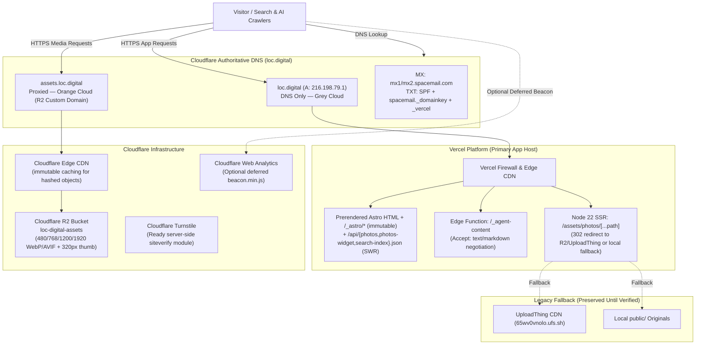
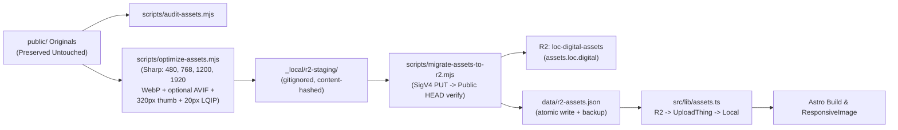

# Cloudflare + Vercel Infrastructure Architecture (`loc.digital`)

## 1. Topology Overview

`loc.digital` uses a clean **split-origin architecture** that avoids double-proxying while combining Vercel's Astro static/SSR edge delivery with Cloudflare's authoritative DNS, zero-egress R2 object storage, and Cloudflare CDN for immutable media.

---

## 2. Routing & Rendering Inventory

Astro is configured with `output: "static"` and `@astrojs/vercel`:

- **Prerendered Static Pages (all public routes):** `/`, `/about`, `/work`, `/work/[slug]`, `/services`, `/writing`, `/writing/[slug]`, `/writing/category/[category]`, `/growth`, `/growth/[slug]`, `/growth/automation`, `/growth/google-ads`, `/growth/meta-ads`, `/growth/metrics`, `/growth/tiktok-shop`, `/photos`, `/photos/[slug]`, `/gear`, `/resume`, `/privacy`, `/music/spotify`, `/entertainment/netflix`, `/404`.
- **Prerendered Public JSON APIs (`prerender = true`):**
  - `/api/photos.json` (full photo feed with EXIF/camera/story metadata)
  - `/api/photos-widget.json` (compact 320px thumbnail feed for macOS Photos widget)
  - `/api/search-index.json` (command palette index)
- **Server-Rendered Route (`prerender = false`):**
  - `src/pages/assets/photos/[...path].ts` — Node 22 serverless function resolving legacy `/assets/photos/*` paths via `resolveAssetUrl` (302 redirect to R2/UploadThing with 5m cache, or local fallback).
- **Post-Build Edge Function:**
  - `/_agent-content` (injected by `scripts/build-agent-content.mjs`) — serves Markdown representations when `Accept: text/markdown` is requested, preserving `Vary: Accept`.
- **Edge Redirects (preserved in `astro.config.mjs`):**
  - `/contact` -> `/about` (`301`)
  - `/service` -> `/services` (`301`)
  - `/experience` -> `/about` (`301`)

---

## 3. Asset Resolution & Migration Pipeline

### Resolution Precedence (`src/lib/assets.ts`)
1. **Verified Cloudflare R2 entry** in `data/r2-assets.json` (supports direct local paths and reverse lookup from UploadThing URLs).
2. **Legacy UploadThing entry** in `data/uploadthing-images.json` (`65wv0vnolo.ufs.sh`).
3. **Local static asset** under `public/`.

---

## 4. Security & Credential Boundaries

| Credential | Scope | Storage | Browser Exposure |
| :--- | :--- | :--- | :--- |
| `R2_ACCOUNT_ID` | Server / CLI scripts | `.env.local` / Vercel Server Env | **Never** |
| `R2_ACCESS_KEY_ID` | Scoped to `loc-digital-assets` | `.env.local` / Vercel Server Env | **Never** |
| `R2_SECRET_ACCESS_KEY` | Scoped to `loc-digital-assets` | `.env.local` / Vercel Server Env | **Never** |
| `TURNSTILE_SECRET_KEY` | Server API routes only | Vercel Server Env | **Never** |
| `UPLOADTHING_TOKEN` | Legacy CLI script only | `.env.local` | **Never** |
| `PUBLIC_ASSET_BASE_URL` | Public CDN origin (`https://assets.loc.digital`) | Build / Client safe | Yes (public URL) |
| `PUBLIC_CF_WEB_ANALYTICS_TOKEN` | Public Web Analytics site token | Build / Client safe | Yes (public beacon token) |
| `PUBLIC_TURNSTILE_SITE_KEY` | Public Turnstile widget key | Build / Client safe | Yes (public site key) |

- `src/lib/storage/r2.ts` and `src/lib/security/turnstile.ts` include explicit runtime guards rejecting browser execution (`typeof window !== "undefined"`).
- `scripts/migrate-assets-to-r2.mjs` installs sanitized exception handlers so signed SigV4 headers or tokens are never printed on failure.
- Zero external S3 SDK packages were added; SigV4 signing uses Node's built-in `node:crypto` + `fetch`.

---

## 5. Detected Redundancies & Audit Findings

1. **Unused dependencies in `package.json`:** `three` (`^0.185.1`) and `@types/three` (`^0.185.4`) have **0 imports** across `src/` and `scripts/` (noted for safe future cleanup; left untouched to avoid unintended lockfile churn during this infrastructure pass).
2. **Duplicate lockfile:** An untracked `package-lock.json` exists alongside the project's primary `pnpm-lock.yaml` (`pnpm-workspace.yaml` is active). Recommend removing the untracked `package-lock.json` after confirming team package manager preference.
3. **Unoptimized portrait image on `/about` (FIXED in this pass):** `public/images/about-photographer.png` (1.66 MB raw PNG) was served directly via ``. Migrated to `<ResponsiveImage>` (`480, 768, 1024` WebP with `priority={true}`) for an immediate >85% image byte reduction on `/about`.
4. **Privacy page alignment:** `src/pages/privacy.astro` currently notes no third-party analytics scripts are installed, while `DashboardLayout.astro` already loads GTM (`GTM-KMGLHHMB`) and now supports optional Cloudflare Web Analytics. Update `privacy.astro` copy before enabling Cloudflare Web Analytics in production.
